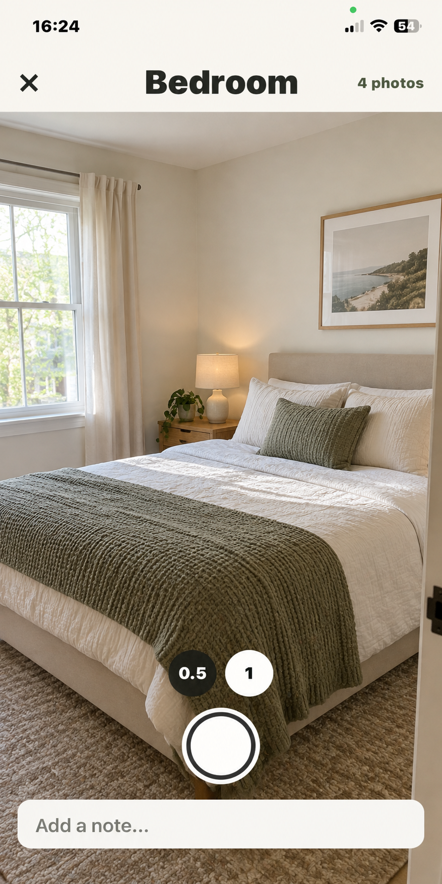
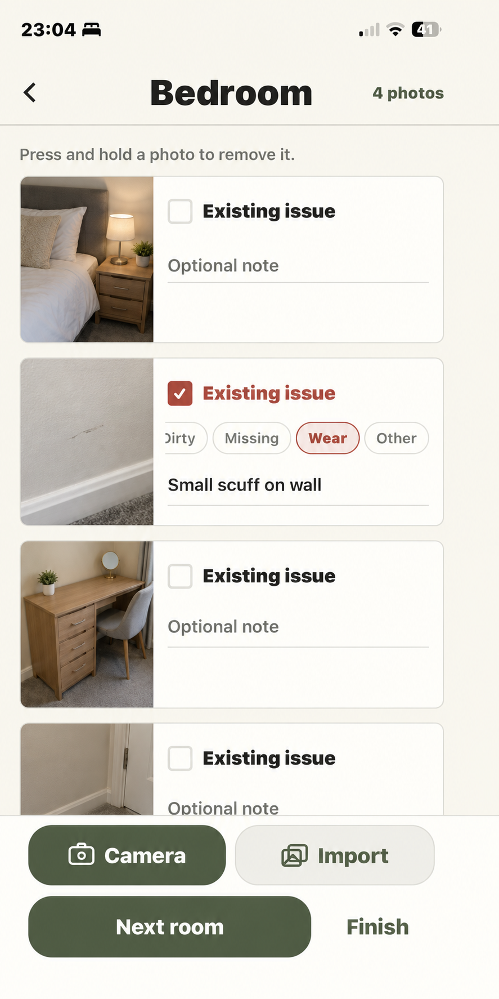
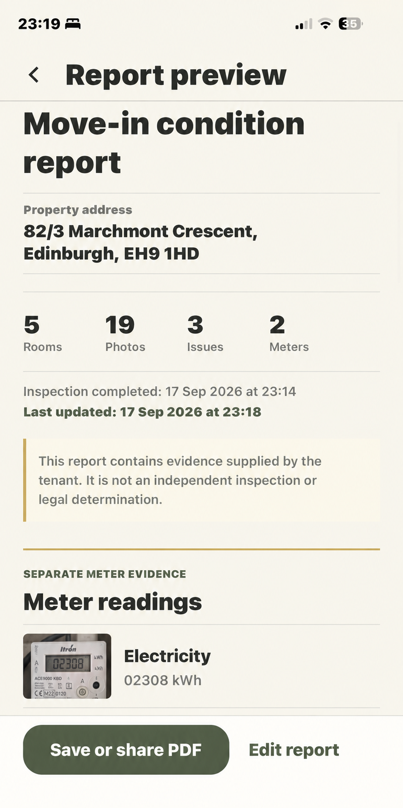
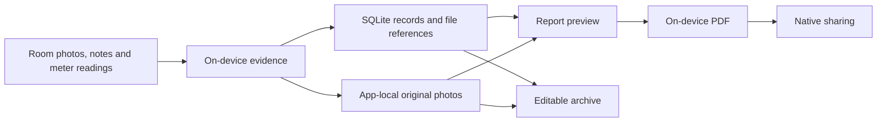

# Deposio

Deposio is an iOS and Android app for documenting a property's condition during a tenancy. I built and independently publish it to keep photographs, notes, issues and meter readings in one record that can be reviewed and shared. [App Store](https://apps.apple.com/gb/app/deposio/id6810157688) · [Google Play](https://play.google.com/store/apps/details?id=com.neilalec.deposio)

## In the app

These iOS test captures show a staged property record, not customer evidence. The address in the report example is fictional.

| Capture a room | Review its evidence | Preview the report |
| --- | --- | --- |
|  |  |  |

The flow starts with room photographs and optional notes or issue labels. A completed record brings the evidence and any meter readings into a report preview. Users can generate and share a PDF, or save an editable `.deposio` archive and import it later. Export is unlocked by an in-app purchase.

## How it works

I built the cross-platform interface with React Native, Expo and TypeScript. SQLite stores the structured records and references to photographs in app-local storage. Report generation prepares the evidence on the device and uses Expo Print to produce a PDF; native sharing hands the file to the platform. The editable archive carries records and original evidence so the work can be reopened, whereas the PDF is a fixed document for reading and sharing.

A captured photograph is moved into app-owned storage before its database entry is committed. That boundary lets evidence persist independently of navigation through the capture flow. Archive import validates the file and its contents before adding records. Purchase handling is kept apart from evidence storage: restoring access to an export does not restore deleted local evidence. For portability, users must save an archive outside the app.

The camera, local files, PDF creation, sharing and purchases all cross native boundaries, so I check these flows on devices as well as with TypeScript checks and focused automated tests. The app also has a limited set of product analytics events; app-authored events contain no addresses, photographs, notes or meter readings.

Deposio is a commercial product and its application source remains private. This repository contains screenshots and a high-level account of the product and engineering decisions, without source code or customer evidence.
